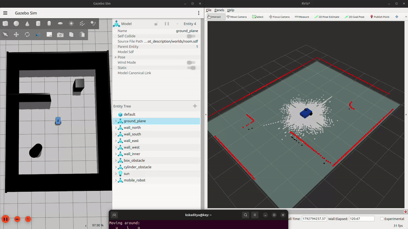
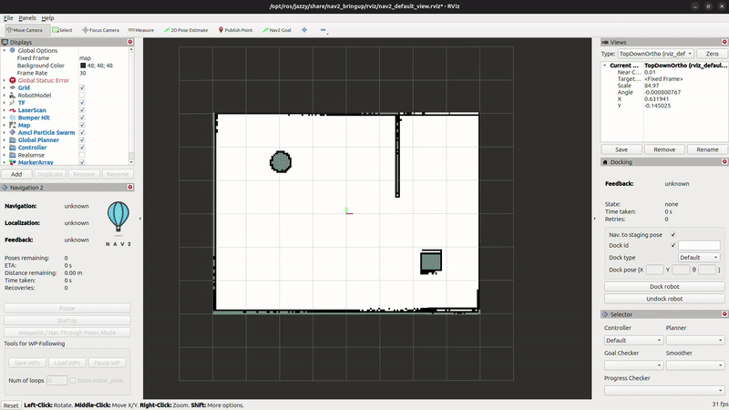

# Autonomous Mobile Robot: SLAM and Navigation (ROS 2 Jazzy + Gazebo)

A differential-drive mobile robot that maps an unknown room with SLAM and then navigates it autonomously with Nav2, simulated in the new Gazebo (Harmonic) on ROS 2 Jazzy.

## Demo

**Mapping with SLAM Toolbox**, driving with the keyboard while the map builds up:



**Autonomous navigation with Nav2**, planning a path around obstacles to a goal set in RViz:



## The robot

- Rear-wheel differential drive with a frictionless front caster
- 360° 2D lidar on a sensor mast, mounted above the chassis so the scan isn't blocked by the robot itself
- Depth camera (RGB-D) at the front
- Modeled in Xacro, with collision and inertia properties for physics simulation

## How it works

The robot's position is tracked through a chain of three frames:

```
map ──► odom ──► base_footprint ──► sensors
```

- **odom → base_footprint:** wheel odometry from Gazebo's diff drive system. Smooth and fast, but drifts over time.
- **map → odom:** the drift correction, from SLAM Toolbox while mapping, or from AMCL while navigating.

**Mapping (SLAM Toolbox):** scan matching aligns each new lidar scan with the map built so far, correcting the odometry's drift, and loop closure corrects the whole trajectory when the robot revisits a known place. The result is saved as an occupancy grid map.

**Navigation (Nav2):** AMCL localizes the robot on the saved map with a particle filter. Costmaps mark walls and obstacles with a safety margin based on the robot's size. The NavFn planner finds a global path, and the MPPI controller follows it, sending velocity commands back to the robot.

Gazebo and ROS 2 communicate through `ros_gz_bridge`: sensor data, odometry, and the clock flow into ROS 2, and velocity commands flow back into Gazebo.

## Tech stack

ROS 2 Jazzy · Gazebo Harmonic · SLAM Toolbox · Nav2 · ros_gz_bridge · Xacro / URDF · Python launch files

## Requirements

- Ubuntu 24.04
- ROS 2 Jazzy

```bash
sudo apt install ros-jazzy-ros-gz ros-jazzy-xacro ros-jazzy-teleop-twist-keyboard \
  ros-jazzy-slam-toolbox ros-jazzy-navigation2 ros-jazzy-nav2-bringup
```

## Build

```bash
cd ~/ros2_ws/src
git clone https://github.com/Aditya3003/mobile-robot.git
cd ~/ros2_ws
colcon build --symlink-install --packages-select mobile_robot_description mobile_robot_navigation
source install/setup.bash
```

## Usage

### 1. Create a map

```bash
# Terminal 1: simulation
ros2 launch mobile_robot_description gazebo.launch.py

# Terminal 2: SLAM
ros2 launch mobile_robot_navigation slam.launch.py

# Terminal 3: RViz (Fixed Frame: map; add Map, LaserScan, RobotModel)
ros2 run rviz2 rviz2 --ros-args -p use_sim_time:=true

# Terminal 4: drive the robot
ros2 run teleop_twist_keyboard teleop_twist_keyboard
```

Drive slowly around the whole room, then save the map while SLAM is still running:

```bash
ros2 run nav2_map_server map_saver_cli \
  -f ~/ros2_ws/src/mobile-robot/mobile_robot_navigation/maps/room \
  --ros-args -p use_sim_time:=true
```

Rebuild the navigation package afterwards, so the new map is installed.

### 2. Navigate autonomously

```bash
# Terminal 1: simulation
ros2 launch mobile_robot_description gazebo.launch.py

# Terminal 2: Nav2
ros2 launch mobile_robot_navigation navigation.launch.py

# Terminal 3: RViz with the Nav2 view
ros2 launch nav2_bringup rviz_launch.py use_sim_time:=true
```

In RViz:

1. **2D Pose Estimate:** click the robot's position on the map (the center of the room) and drag in the direction it faces.
2. **2D Goal Pose:** click a destination and drag to set the final heading. The robot plans a path and drives there.

## Project structure

```
mobile-robot/
├── mobile_robot_description/     # Robot model and simulation
│   ├── urdf/
│   │   └── mobile_robot.urdf.xacro
│   ├── worlds/
│   │   └── room.sdf
│   └── launch/
│       └── gazebo.launch.py
├── mobile_robot_navigation/      # Mapping and navigation
│   ├── config/
│   │   ├── slam_params.yaml
│   │   └── nav2_params.yaml
│   ├── maps/
│   │   ├── room.pgm
│   │   └── room.yaml
│   └── launch/
│       ├── slam.launch.py
│       └── navigation.launch.py
└── docs/                         # Demo GIFs
```

## Notes

- **Driving uses Gazebo's built-in DiffDrive system** rather than `gz_ros2_control`. With the current Jazzy packages, `gz_ros2_control` failed to pass its controller parameter file to the controllers, so the robot is driven directly by Gazebo, with velocity commands and odometry passed through the bridge.
- **The Nav2 and SLAM Toolbox configurations** are based on the packages' defaults, adapted to this robot's frames (`base_footprint`) and size (`robot_radius: 0.32`).

## Planned

- Sensor fusion of wheel odometry and an IMU with an EKF (`robot_localization`) for more accurate localization

## Author

Sai Krishna Aditya Kambhampati